# Mapu Android
Mapu (Map for You) is a travel guide application that helps users discover curated city guides built on top of Google Maps. Each guide contains recommendations for attractions, restaurants, cafés and other points of interest, allowing travellers to explore destinations through interactive, custom maps. 
 
## MVP scope

### Features
- Sign In screen integrated with Google Sign In
- Guides tab to browse available guide maps
- Open guide details and display embedded Google My Map
- Profile tab
- Support English and Portuguese localisation
- Support Dark mode
- Accessibility

## Technical Approach

- Kotlin-first development 
- Jetpack Compose
- Material 3
- MVVM + reactive and clean architecture
- Repository Pattern
- Hilt Dependency Injection
- Unit Tests
- Modular, scalable architecture
- Google Sign In for login
- Language support (Portuguese and English Localization)
- Build with Accessibility in mind (screen reader and design requirements)

## Design

Simple and elegant, with an editorial travel-guide feel. Theme lives in `core/designsystem/theme`.

### Colour palette (Vino)

| Role | Light | Dark | Use |
|---|---|---|---|
| Primary | Marsala `#7A2E3A` | `#E3A48F` | Logo, main actions, featured content |
| Secondary | Deep green `#2F4A3C` | `#A9CDB6` | Nature and map cues, selected states |
| Tertiary | Burnt orange `#B5541C` | `#F0A473` | Pins and highlights |
| Accent | Ochre `#B8953A` | `#D9BC6E` | Small badges only (not for text) |
| Background | `#FAF6F1` | `#171213` | Warm off-white / warm near-black |

Containers use warm clay and sand tints rather than pink, so the palette stays neutral. Dynamic colour is off so the brand palette always shows.

### Typography

- **Fraunces** (serif) for display, headline and large titles
- **Manrope** (sans-serif) for titles, body and labels

Both are bundled as variable fonts in `res/font` (SIL Open Font License).

### Mock-ups

| Login | Guides | Profile |
|---|---|---|
| 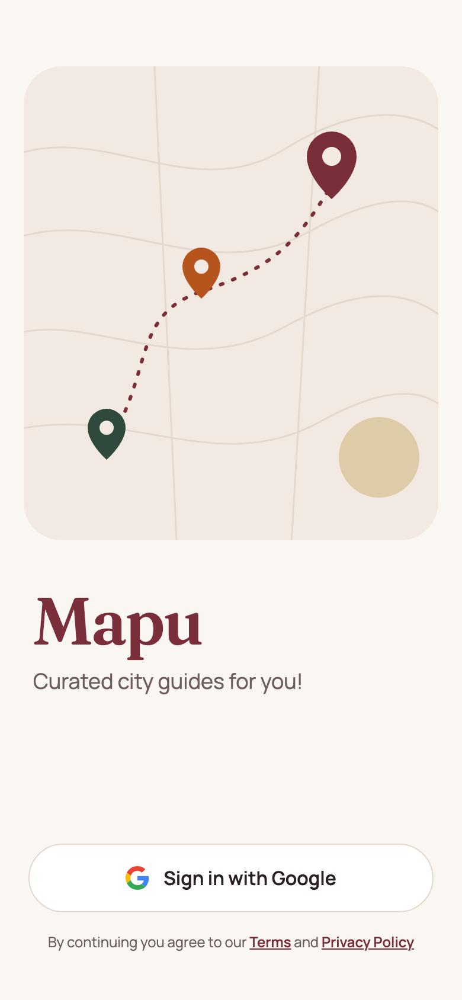 | 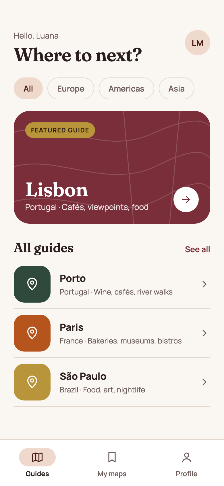 | 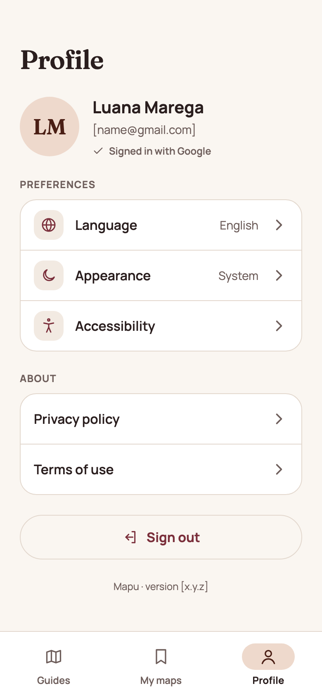 |
| 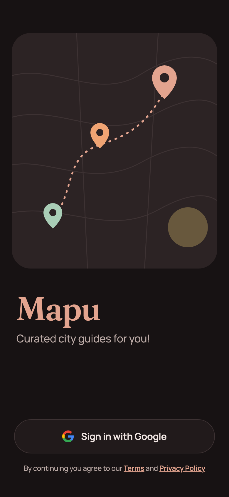 | 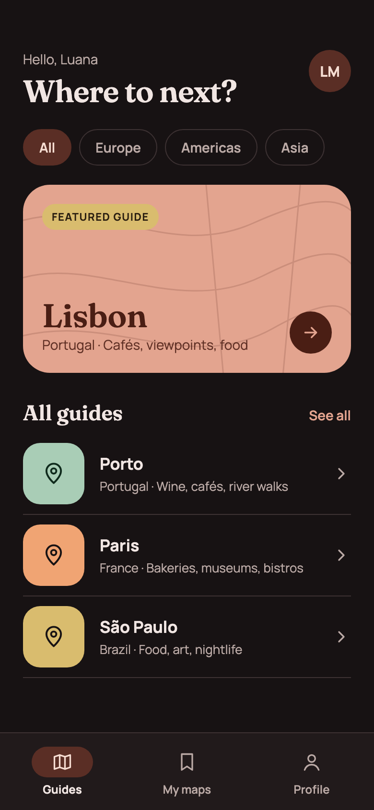 | 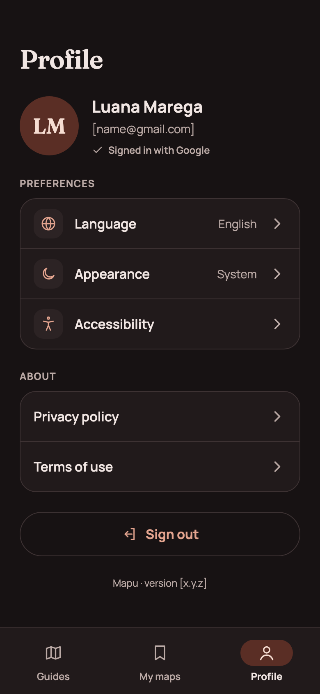 |

#### Login errors and alerts

Errors appear in a card above the Sign in button, so screen readers announce them before the retry action. When Google Play services is missing, the button is hidden because retrying can't help. When it needs updating, a dialog asks the user to update it.

| No Google account | Sign-in failed | Update Play services | Play services unavailable |
|---|---|---|---|
| 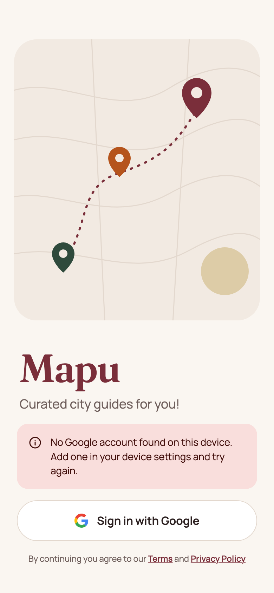 | 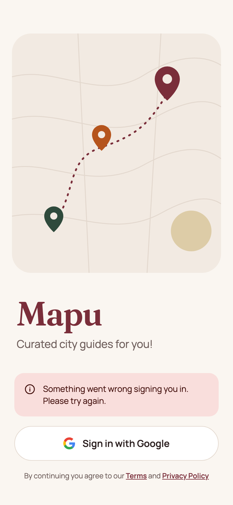 | 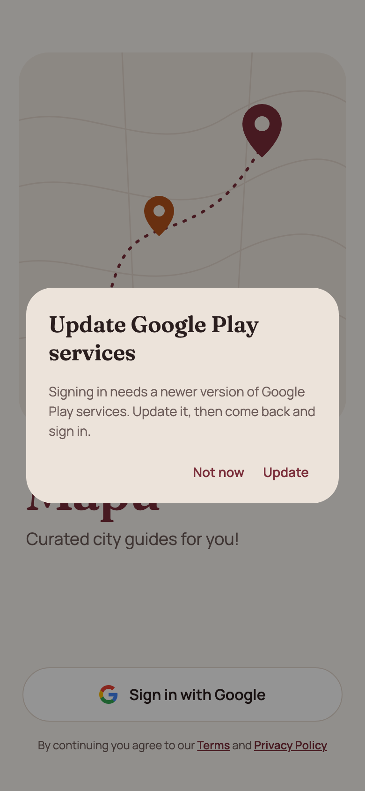 | 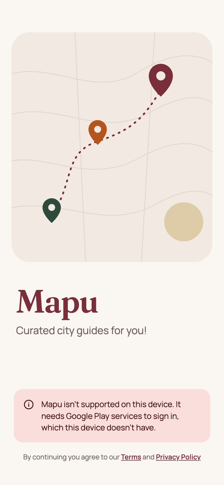 |
| 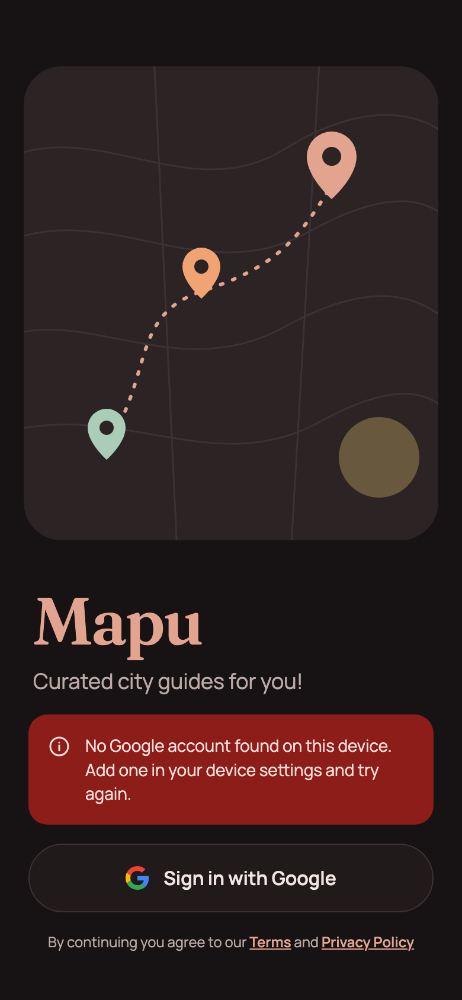 | 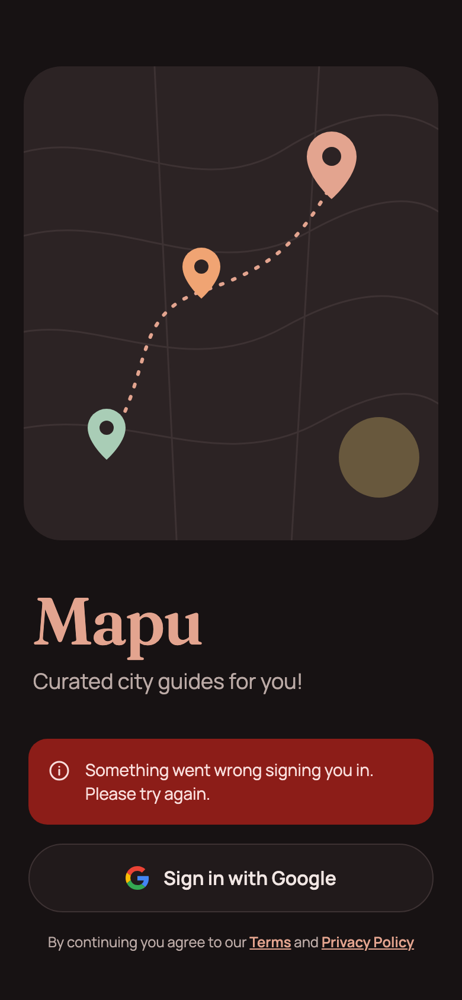 | 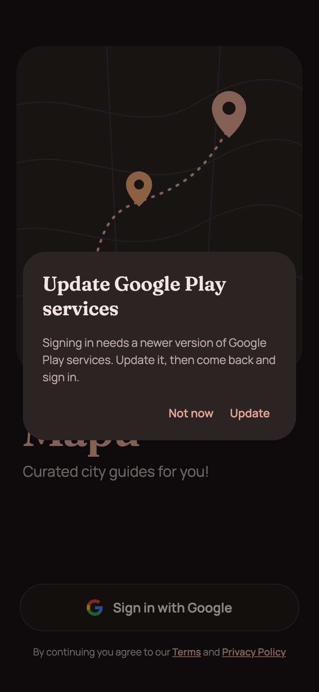 | 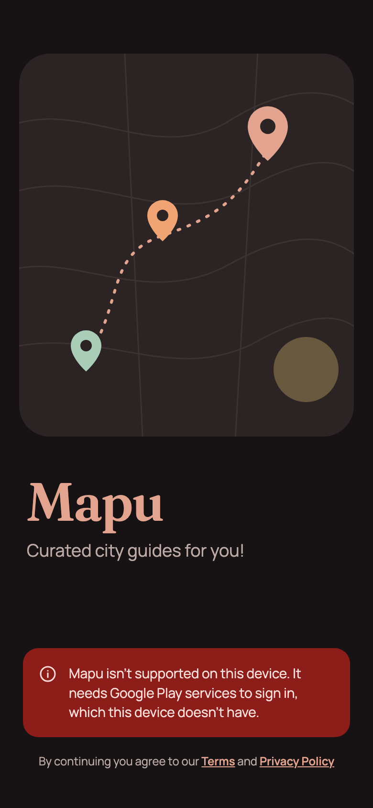 |

## Architecture

## Roadmap

- Guide details view, Integrate with Google Maps SDK, and have a list of places I want to display that will be fetched either locally in a JSON file/ Room database (first / fastest solution for now) or from a backend service (ideal / for later on because it adds complexity of creating an api and database that can store and manage user details, lists of places and locations to be rendered in the map), then we’ll render each pin in the map with some information about it and users can interact with the map. This new map will replace the embedded static map.
- My maps tab, where a list of the saved maps is. Basically a list of the maps the person has copied to their account, so basically they can view the Maps in the Guide tab and copy them over to their account. (Still thinking if we allow copying the whole maps or add it to their selected map in a pin by pin basis, as in, they click on the pins in our pre-made maps and can add them to one of their own maps, so basically a list of available maps would be displayed and they would choose in which map they want to save it. Ideally there will be a database with their saved maps and the pins in each map that we can then render to the user and allow them to edit or remove from the map. Google Maps API charges for Places search so for this app we’ll only allow them to copy places from the existing map guides (which will be already saved in our database), they will not be able to search for places as they would do in the google maps website.
- Support offline mode so people can see the maps offline (to be implemented in the future) 

