# Mapu Android
Mapu (Map for You) is a travel guide application that helps users discover curated city guides built on top of Google Maps. Each guide contains recommendations for attractions, restaurants, cafés and other points of interest, allowing travellers to explore destinations through interactive, custom maps. 
 
## MVP scope

### Features
- Sign In screen integrated with Google Sign In
- Guides tab to browse available guide maps
- Open guide details and display a map with suggested places, with pins by category and place details
- Profile tab
- Support English and Portuguese localisation
- Support Dark mode
- Accessibility

## Technical Approach

- Kotlin-first development 
- Jetpack Compose
- Material 3
- MVVM + reactive and clean architecture
- Repository Pattern
- Hilt Dependency Injection
- Unit Tests
- Modular, scalable architecture
- Google Sign In for login
- MapLibre with OpenFreeMap for the maps, with places from Google My Maps (KML)
- Language support (Portuguese and English Localization)
- Build with Accessibility in mind (screen reader and design requirements)

## Design

Simple and elegant, with an editorial travel-guide feel. Theme lives in `core/designsystem/theme`.

### Colour palette (Vino)

| Role | Light | Dark | Use |
|---|---|---|---|
| Primary | Marsala `#7A2E3A` | `#E3A48F` | Logo, main actions, featured content |
| Secondary | Deep green `#2F4A3C` | `#A9CDB6` | Nature and map cues, selected states |
| Tertiary | Burnt orange `#B5541C` | `#F0A473` | Pins and highlights |
| Accent | Ochre `#B8953A` | `#D9BC6E` | Small badges only (not for text) |
| Background | `#FAF6F1` | `#171213` | Warm off-white / warm near-black |

Containers use warm clay and sand tints rather than pink, so the palette stays neutral. Dynamic colour is off so the brand palette always shows.

### Typography

- **Fraunces** (serif) for display, headline and large titles
- **Manrope** (sans-serif) for titles, body and labels

Both are bundled as variable fonts in `res/font` (SIL Open Font License).

### Mock-ups

| Login | Guides | Profile |
|---|---|---|
| 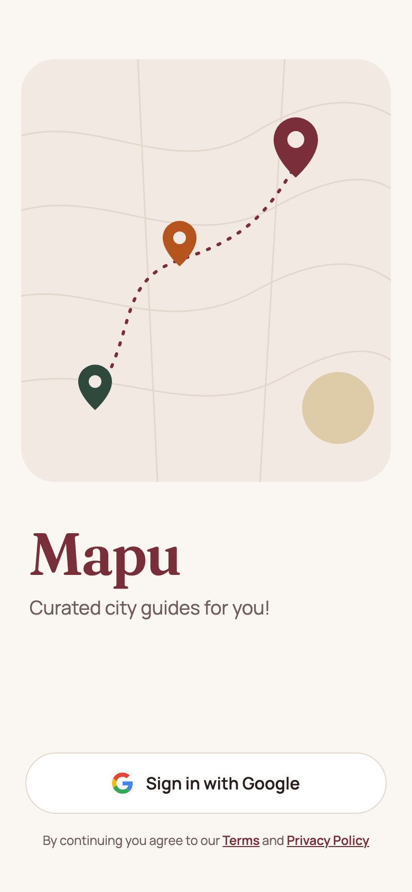 | 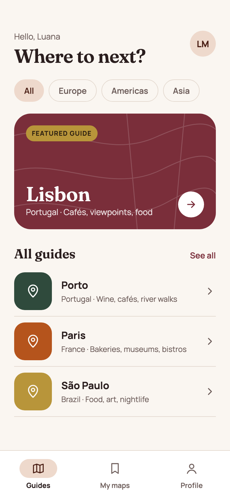 | 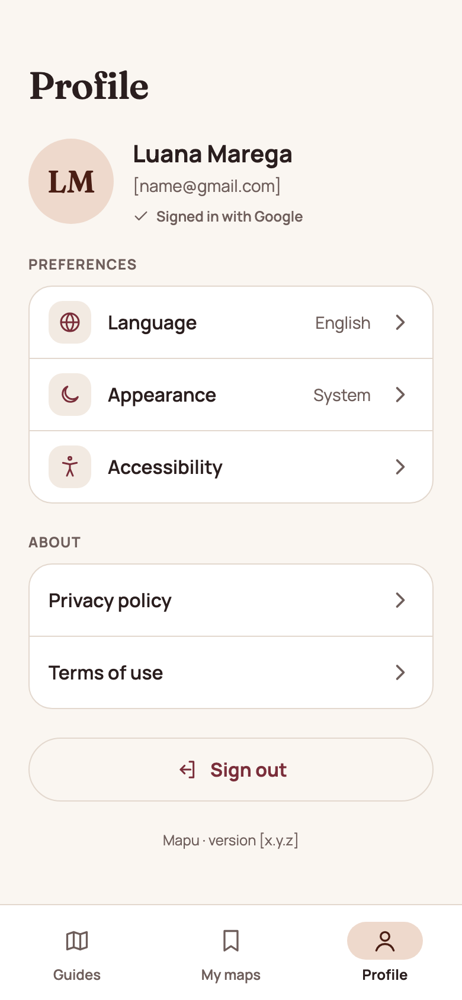 |
| 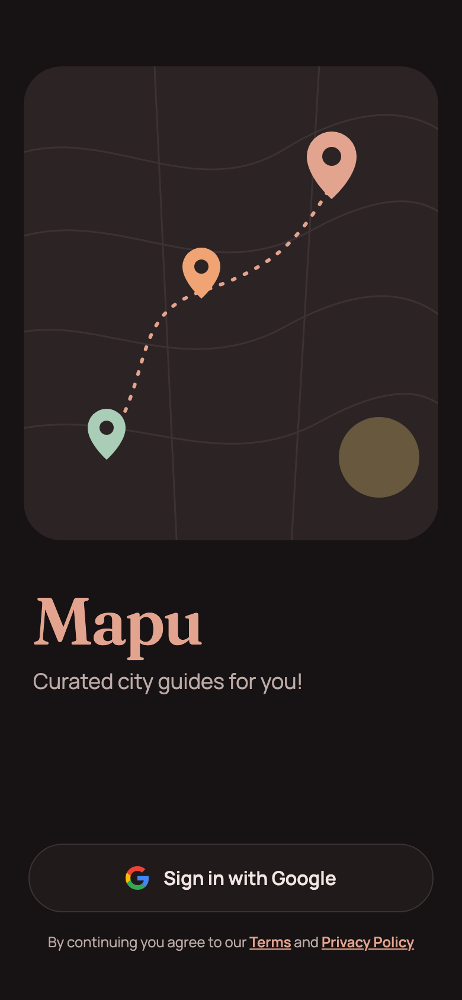 | 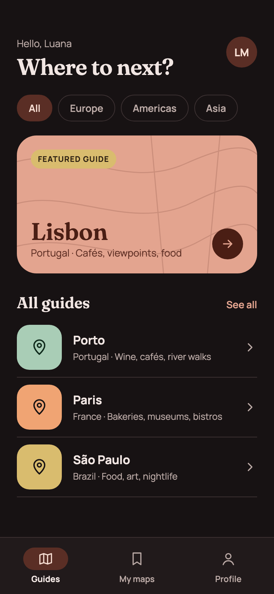 | 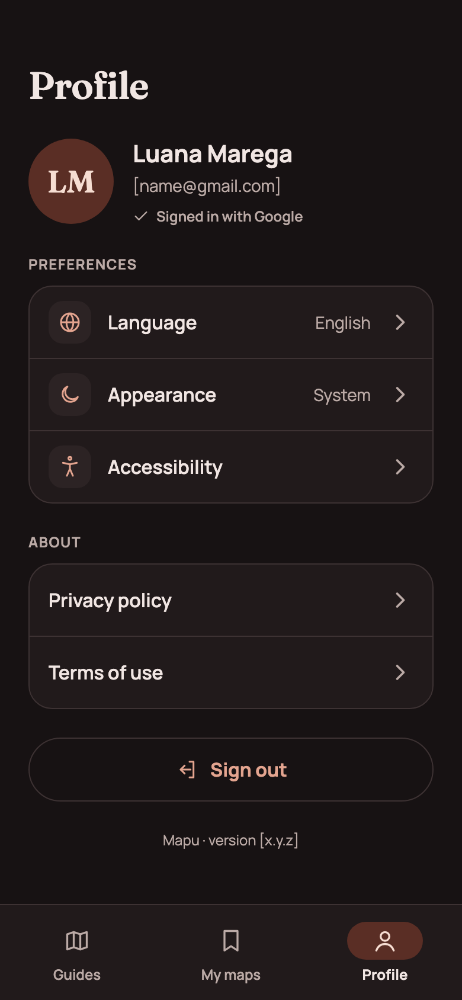 |

#### Login errors and alerts

Errors appear in a card above the Sign in button, so screen readers announce them before the retry action. When Google Play services is missing, the button is hidden because retrying can't help. When it needs updating, a dialog asks the user to update it.

| No Google account | Sign-in failed | Update Play services | Play services unavailable |
|---|---|---|---|
| 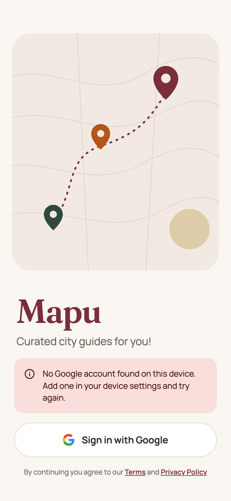 | 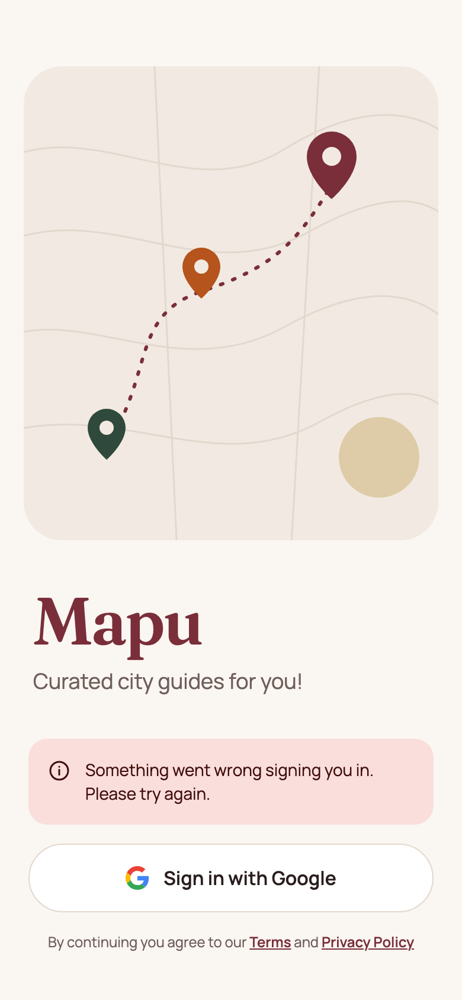 | 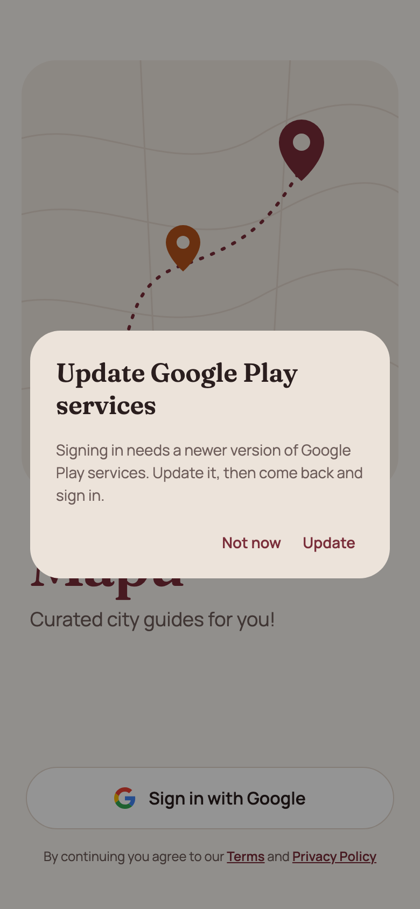 | 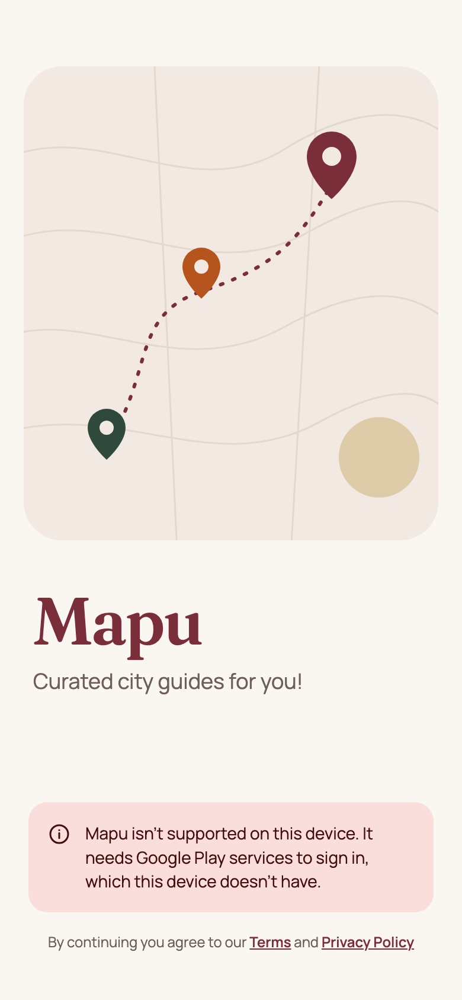 |
| 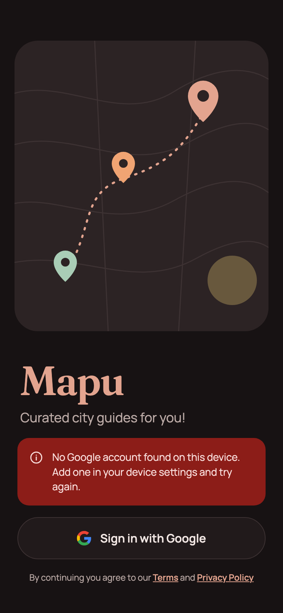 | 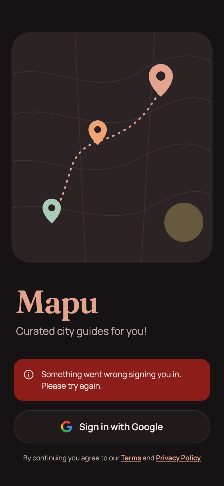 | 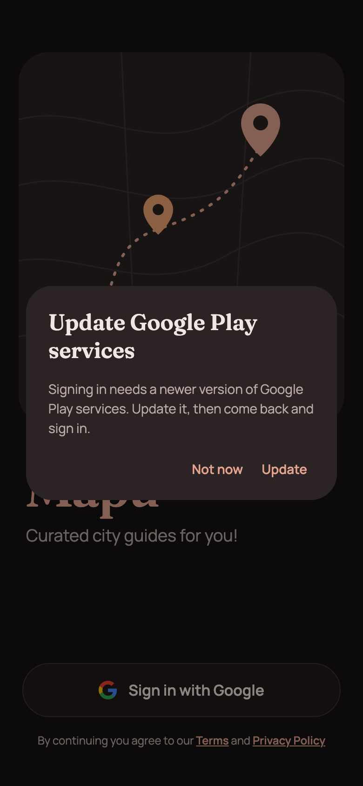 | 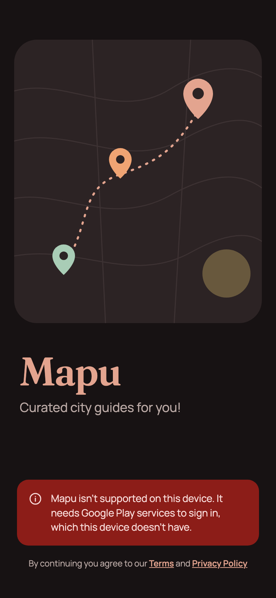 |

## Maps

Each city guide is a map I create in Google My Maps, with one layer per category (Restaurants, Museums, Parks, ...). The app downloads the map as KML, turns each pin into a `Place` and draws it natively with [MapLibre](https://maplibre.org) on an [OpenFreeMap](https://openfreemap.org) base map.

Why this approach:
- **Easy to edit** - places are managed in My Maps, so updating a guide doesn't need a new app release.
- **Native experience** - custom pins and colours, dark mode, accessibility and a bottom sheet with place details, which an embedded My Maps web view can't offer.
- **Free** - OpenFreeMap needs no API key or billing account. The Google Maps SDK needs a billing account, even though its native maps are free.
- **Easy to change** - screens only use the app's own `Guide` and `Place` models. Moving the places to a backend or changing the map provider only changes the data source or the map composable.
- **Ready for other sources** - the map screen shows any list of places, so a user's saved maps or a guide created with AI can use the same screen later, with a different data source.

In the MVP, the guides list comes from a local JSON file, with the city details and the My Maps id for each guide.

## Architecture

## Roadmap

Ideas for after the MVP. Still to be defined.

The plan is to finish the MVP first, then add Firestore and My maps, then the AI guide creator, as each step builds on the one before.

- **My maps** - a tab with the user's saved guides and their own custom maps (e.g. copying pins from my guides into "My London"), stored per user in Firestore and shown on the same map screen.
- **AI guide creator (idea in progress)** - users answer a few questions about their trip (destination or "surprise me", days, interests, budget, food and hotel style) and an AI agent suggests places to see, eat and stay. They pick the ones they like and save them as one of their maps. Later versions could refine the guide by chatting with the agent, or build a day by day itinerary. Still being thought through: the backend, costs and how to make sure suggested places are real.

For more details and the full list of tasks, see the [backlog](documentation/roadmap/BACKLOG.md).
